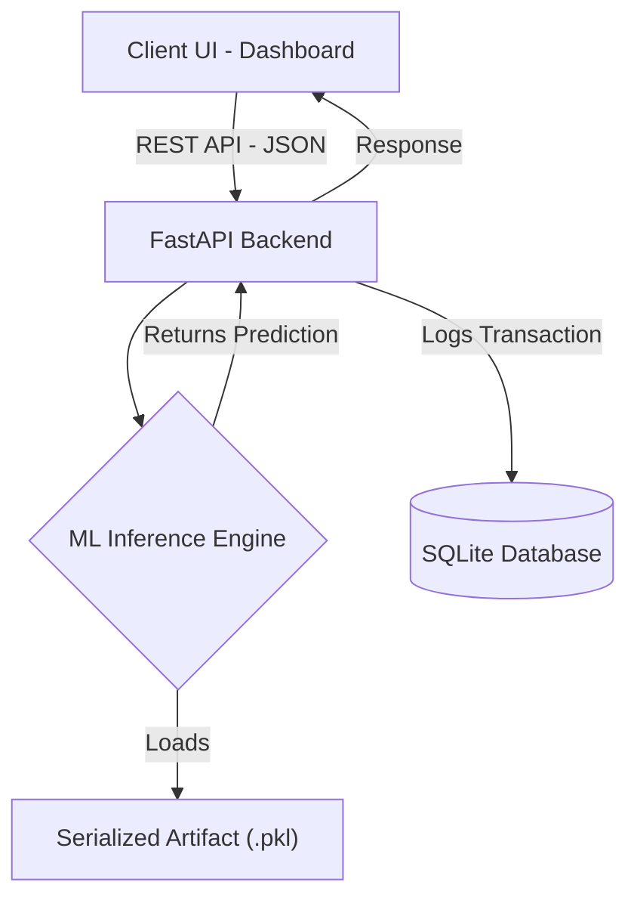

<div align="center">

# Md Huzaifa Ansari

### Machine Learning Engineer • Systems & Production ML
**Bachelor in Computer Science @ Indian Institute of Technology Patna | CPI: 9.62**

<a href="https://git.io/typing-svg">
  
</a>

<br>

<p align="center">
  <a href="https://www.linkedin.com/in/md-huzaifa-ansari/"></a>&nbsp;
  <a href="https://www.kaggle.com/neurocipher"></a>&nbsp;
  <a href="https://github.com/AnsariHuzaif97"></a>&nbsp;
  <a href="mailto:huzaifaofficial80@gmail.com"></a>&nbsp;
  <a href="https://www.iitp.ac.in/"></a>
</p>

<p align="center">
  <a href="https://www.kaggle.com/neurocipher"></a>
  <a href="https://www.kaggle.com/neurocipher"></a>
  
  
</p>

</div>

---

<p align="center">
  <i>🚀 "I architect low-latency machine learning systems, derived from mathematical first principles and deployed as containerized production microservices."</i>
</p>

---

### 👤 Profile Overview

<table>
<tr>
<td width="60%" valign="top">

### 💡 Who I Am

I am **Md Huzaifa Ansari** — a **Machine Learning Engineer & Systems Architect** with a **Bachelor in Computer Science from the Indian Institute of Technology Patna (CPI: 9.62)**.

My technical focus centers on bridging theoretical machine learning foundations with high-throughput production infrastructure:
* **Microservice Engineering:** Architecting decoupled, asynchronous REST inference engines with **FastAPI**, **Docker**, and real-time transaction auditing in **SQLite**.
* **Generative Tabular Modeling:** Formulating **GAIN** architectures in **PyTorch** & **TensorFlow** with custom minimax objectives and **Optuna** Bayesian optimization.
* **Algorithmic Foundations:** Deriving numerical solvers from first principles in **C-contiguous NumPy**, including dual quadratic programming under **KKT** conditions.
* **Global Kaggle Standing:** Dual Expert ranked **#185 in Datasets (Top 0.3%)** and **#752 in Notebooks (Top 1.25%)** globally.

</td>
<td width="40%" valign="top">

### ⚡ At a Glance

```yaml
name:       Md Huzaifa Ansari
github:     AnsariHuzaif97
degree:     Bachelor in Computer Science
institute:  IIT Patna (CPI: 9.62)
kaggle:     Dual Expert (Top 0.3% / 1.25%)
focus:      Systems ML · Inference Engines
serving:    FastAPI · Docker · SQLite
latency:    Sub-10ms Execution SLA
imputation: GAIN (PyTorch / TensorFlow)
algorithms: NumPy Internals · Convex QP
```

</td>
</tr>
</table>

---

### 🔭 Currently Building & Learning

<table>
<tr>
<td width="50%" valign="top">

#### 🛠️ Building
* 🛡️ **AegisCore Platform:** Containerized fraud intelligence engine featuring automated SMOTE class rebalancing, asynchronous FastAPI REST endpoints, and thread-safe SQLite transaction logging.
* ⚡ **High-Throughput REST Engines:** Sub-10ms asynchronous inference pipelines built on FastAPI and Uvicorn with serialized model artifacts (`.pkl` / ONNX).
* 🧬 **Generative Tabular Imputation:** GAIN implementations with minimax loss $V(G,D)$ and Hint matrix $H$ conditioning for non-random missingness.
* 🧮 **Algorithmic Solvers From Scratch:** Vectorized dual SVM solvers with explicit KKT stationarity, primal, and dual feasibility verification.

</td>
<td width="50%" valign="top">

#### 🌱 Learning & Exploring
* 🔬 **Low-Level Tensor Internals:** C vs. Fortran memory contiguity, N-dimensional striding, and zero-copy transformations for SIMD speedups.
* ⚙️ **Optimized Runtime Graphs:** Profiling ONNX Runtime C++ execution pipelines and multi-worker ASGI process management.
* 🔍 **Explainability (XAI) Streams:** Real-time TreeSHAP feature attributions and distribution drift telemetry under strict leakage-free splits.
* 📐 **Interior-Point Methods:** Convex quadratic programming algorithms and boundary condition enforcement for constrained optimization.

</td>
</tr>
</table>

---

### 💼 Tech Stack & Systems Taxonomy

<div align="center">

<p align="center">
  
</p>

| Category | Technologies & Tools with Official Symbols |
| :--- | :--- |
| **🧠 Languages & Core** | [](#)&nbsp; [](#)&nbsp; [](#)&nbsp; [](#)&nbsp; [](#)&nbsp; [](#) |
| **🤖 Machine Learning & DL** | [](#)&nbsp; [](#)&nbsp; [](#)&nbsp; [](#)&nbsp; [](#)&nbsp; [](#) |
| **☁️ Systems & Serving** | [](#)&nbsp; [-499848?style=flat-square&logo=gunicorn&logoColor=white)](#)&nbsp; [](#)&nbsp; [](#)&nbsp; [](#)&nbsp; [](#) |
| **🧮 Optimization & Numerics** | [](#)&nbsp; [](#)&nbsp; [](#)&nbsp; [](#)&nbsp; [](#) |
| **🔍 Auditing & Code Standards** | [](#)&nbsp; [](#)&nbsp; [](#)&nbsp; [](#) |

</div>

---

### ⚙️ AegisCore: Microservice & Inference Architecture



---

### 📌 Featured Production Projects

<table>
<tr>
<td width="50%" valign="top">

### 🛡️ [`aegiscore-fraud-detection`](https://github.com/AnsariHuzaif97/aegiscore-fraud-detection)
**Enterprise Fraud Intelligence Platform**
* Decoupled microservice architecture with low-latency REST endpoints.
* Synthetic Minority Over-sampling Technique (SMOTE) class balancing.
* Serialized inference engine (`.pkl`) with async SQLite transaction logging.
* **Tech Stack:** `Python 3.10` • `FastAPI` • `Docker` • `SMOTE` • `SQLite`
* **Status:** `Dockerized Microservice` • `Sub-10ms Execution SLA`

</td>
<td width="50%" valign="top">

### 🧬 [`gain-tabular-imputation`](https://github.com/AnsariHuzaif97/gain-tabular-imputation)
**Generative Adversarial Imputation Engine**
* Production implementation of GAIN for missing tabular data reconstruction.
* Minimax loss $V(G,D)$ optimization with Hint matrix $H$ conditioning.
* Automated Bayesian hyperparameter search powered by Optuna.
* **Tech Stack:** `PyTorch` • `TensorFlow` • `Optuna` • `NumPy` • `SciPy`
* **Status:** `Pip-Installable Package` • `PyPI Ready`

</td>
</tr>
<tr>
<td width="50%" valign="top">

### 🧮 [`svm-from-scratch-py`](https://github.com/AnsariHuzaif97/svm-from-scratch-py)
**Dual Convex Optimization Engine**
* Pure algorithmic Support Vector Machine implementation from first principles.
* Dual Lagrangian formulation solved via SciPy quadratic programming.
* Analytical validation of Karush-Kuhn-Tucker (KKT) conditions.
* **Tech Stack:** `Python` • `NumPy (C-Contiguous)` • `SciPy (QP)`
* **Status:** `Algorithmic Engine` • `Zero-Dependency Core`

</td>
<td width="50%" valign="top">

### 🔬 [`numpy-internals-guide`](https://github.com/AnsariHuzaif97/numpy-internals-guide)
**Low-Level Memory & Vectorization Mechanics**
* Systems-level profiling of C-contiguous vs. Fortran memory layouts.
* In-depth exploration of N-dimensional tensor strides and zero-copy slicing.
* High-throughput numerical transformations for low-latency ML inference.
* **Tech Stack:** `C-Python API` • `NumPy Internals` • `Memory Profiler`
* **Status:** `Technical Specification` • `Open-Source Benchmark`

</td>
</tr>
</table>

---

### 📊 Competitive Machine Learning & Research Credentials

<div align="center">

| Track | Global Standing | Volume & Recognitions | Engineering Impact |
| :--- | :---: | :---: | :--- |
| **Kaggle Notebooks** | **Rank #752**<br>*(Top 1.25% Globally)* | **16 Medals**<br>30 Public Production Notebooks | End-to-end predictive pipelines, leakage-free cross-validation architectures, and production exploratory algorithms. |
| **Kaggle Datasets** | **Rank #185**<br>*(Top 0.3% Globally)* | **2 Medals**<br>3 Curated Production Datasets | High-utility tabular datasets built with schema constraints, zero data leakage, and rigorous statistical metadata. |
| **Community Engagement** | **Global Contributor**<br>*(NeuroCipher)* | **640+ Upvotes**<br>540+ Production Forks | Consistently utilized by practitioners for machine learning baselines, numerical foundations, and pipeline design. |

</div>

---

### 📈 GitHub Metrics & Analytics Dashboard

<div align="center">

<table border="0">
<tr>
<td width="50%">
  
</td>
<td width="50%">
  
</td>
</tr>
</table>

<table border="0">
<tr>
<td width="50%">
  
</td>
<td width="50%">
  
</td>
</tr>
</table>


</div>

---

### 🎙️ Content, Community & Recognition

<table>
<tr>
<td width="33%" valign="top">

#### ✍️ Technical Research & Writing
* **Author:** Deep-dive systems guides on *NumPy Internals & Vectorized Memory*.
* **Open Source Baselines:** 30+ public algorithmic pipelines and exploratory engines.
* **Generative Tabular Research:** Mathematical formulations of GAIN with minimax loss.
* **Curated Data Assets:** 3 production datasets with schema invariants & zero leakage.

</td>
<td width="34%" valign="top">

#### 🔬 Systems & Open Source
* **AegisCore Architecture:** Decoupled FastAPI microservice serving with sub-10ms SLAs.
* **Community Footprint:** Adopted across **540+ forks** and **640+ upvotes** globally.
* **Rigorous Validation:** Enforcement of leakage-free stratified group cross-validation.
* **Academic Foundations:** Computer Science peer collaboration at **IIT Patna**.

</td>
<td width="33%" valign="top">

#### 🏅 Honors & Recognition
* 🥇 **Kaggle Datasets Expert** — Global Rank **#185** *(Top 0.3%)*
* 🥇 **Kaggle Notebooks Expert** — Global Rank **#752** *(Top 1.25%)*
* 🎖️ **18 Medals Earned** (16 Code Medals • 2 Dataset Medals)
* 🎓 **Academic Standing:** CPI **9.62** @ IIT Patna (B.Tech CS)

</td>
</tr>
</table>

<div align="center">

<p align="center">
  <a href="https://www.linkedin.com/in/md-huzaifa-ansari/"></a>&nbsp;
  <a href="https://www.kaggle.com/neurocipher"></a>&nbsp;
  <a href="https://github.com/AnsariHuzaif97"></a>
</p>

<table>
<tr>
<td align="center">
  <br>
  <i>"Should array indices start at 0 or 1? My compromise of 0.5 was rejected without, I thought, proper consideration."</i>
  <br><br>
  <b>— Stan Kelly-Bootle</b>
  <br><br>
</td>
</tr>
</table>

<p><i>Thanks for visiting — let's build production-grade ML systems together.</i></p>
<p>⭐ <i>If you find my work useful, consider following or starring a repo.</i></p>

</div>
